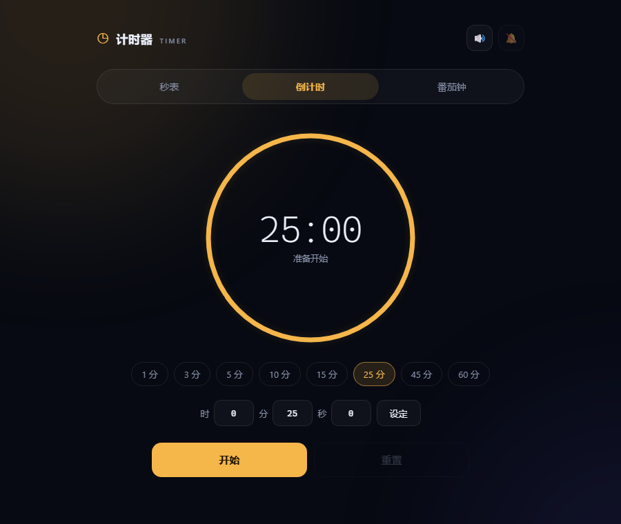

# ⏱ 计时器 Timer

一个简洁好用的在线计时器，包含 **秒表**、**倒计时** 和 **番茄钟** 三种模式。

纯前端实现，零依赖、零构建，双击 `index.html` 就能用。



## ✨ 功能

**秒表**
- 开始 / 暂停 / 继续，精度 0.01 秒
- 计次（分段计时），自动标记最快与最慢的一段
- 刷新页面后继续计时，不会丢失

**倒计时**
- 1 / 3 / 5 / 10 / 15 / 25 / 45 / 60 分钟快捷预设
- 支持自定义 时 : 分 : 秒
- 环形进度实时显示剩余时间
- 结束提示音 + 桌面通知 + 视觉脉冲

**番茄钟**
- 专注 25 分钟 / 短休 5 分钟 / 长休 15 分钟（可自定义）
- 每完成 4 轮专注自动进入长休息
- 可选择是否自动开始下一阶段
- 记录当前轮次，支持跳过与重置

**通用**
- 深色主题，随模式切换强调色
- 响应式布局，手机和桌面都能用
- 快捷键操作
- 刷新/关闭页面后自动恢复计时状态（localStorage）
- 支持 `?mode=countdown` 这类深链接直接打开某个模式

## 🚀 在线使用

部署到 GitHub Pages 后可直接访问：

```
https://klant.github.io/timer-app/
```

### 启用 GitHub Pages

1. 打开仓库的 **Settings → Pages**
2. **Source** 选择 `Deploy from a branch`
3. **Branch** 选择 `main`，目录选 `/ (root)`，点击 **Save**
4. 等待约 1 分钟即可通过上面的地址访问

## 💻 本地运行

无需安装任何依赖，直接用浏览器打开 `index.html` 即可。

也可以启动一个本地静态服务器：

```bash
# Python 3
python -m http.server 8000

# 或者 Node.js
npx serve .
```

然后访问 <http://localhost:8000>。

## ⌨️ 快捷键

| 按键 | 作用 |
| --- | --- |
| `空格` | 当前模式 开始 / 暂停 |
| `L` | 秒表计次 |
| `S` | 番茄钟跳过当前阶段 |
| `R` | 重置当前模式 |
| `1` / `2` / `3` | 切换到 秒表 / 倒计时 / 番茄钟 |
| `←` / `→` | 在标签页之间切换 |

> 提示：桌面通知需要浏览器授权，点击右上角 🔔 即可开启。

## 📁 项目结构

```
timer-app/
├── index.html      # 页面结构
├── styles.css      # 样式与主题
├── app.js          # 计时逻辑、状态持久化
├── docs/
│   └── preview.png # README 预览图
└── LICENSE
```

## 🔧 实现说明

- **计时精度**：基于 `Date.now()` 计算目标结束时间，而不是累加 `setInterval`，即使页面切到后台或系统卡顿也不会产生累积误差。
- **后台提醒**：页面隐藏时仍以 250ms 间隔检查是否到点，配合 Web Audio 提示音和 Notification API 提醒。
- **状态恢复**：计时状态保存在 `localStorage`，刷新后若是运行中的计时会按真实时间继续。
- **无依赖**：原生 HTML / CSS / JavaScript，不引入任何框架或第三方库。

## 📄 License

[MIT](LICENSE)
